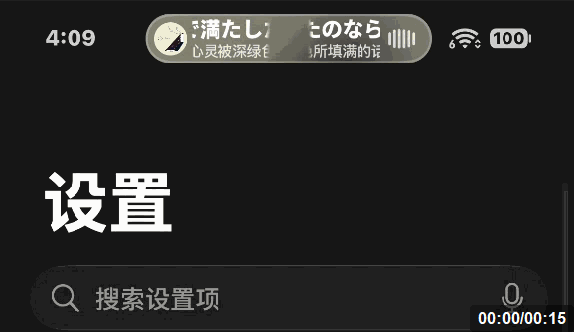
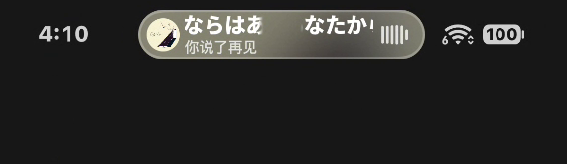

# TerraMoor

TerraMoor 是一个 ColorOS 17 的 LSPosed 模块，在系统原生流体云中显示双语歌词，支持实时调参、无歌词回退和模糊封面背景。

## 预览

| 应用内预览 | 系统流体云 |
| --- | --- |
|  |  |

## 安装

1. 在 Releases 下载 APK。首版适配 `PKX110_17.0.0.104(CN01)`，SystemUI `17.99.02`，SystemUIPlugin `17.000.002`，需要支持现代模块 API 102 的 LSPosed。
2. 启用 TerraMoor，作用域勾选「系统界面」，重启 SystemUI 或手机后打开 TerraMoor。应用内的重启按钮需要 Root 授权。
3. 在首页查看歌词提供者状态。播放器若未发布同步歌词，可安装 ColorOS Live Lyrics Bridge，并为播放器选用专用或通用 Provider。安装状态和歌词可用状态是两件事。
4. 旧调试包可在「关于」导出配置，正式包导入后停用旧模块。同一时间启用一个 TerraMoor 包。

## 模块结构

源码在 `app/src/main/java/shop/terramoor/github/io/`。

| 目录 | 职责 |
| --- | --- |
| `settings/` | COUI 首页、调整页和关于页，Provider 状态与入口，后台串行远程配置写入，预览和 JSON 备份。 |
| `lyrics/` | 读取媒体会话的 `lyricInfo`，解析 LRC 和可匹配的 TTML 句尾，计算下一句预显和横向滚动进度。 |
| `systemui/` | 挂载媒体胶囊 Hook，校验固件、媒体会话及视图所有权；在原生动画内绘制歌词与背景，停用时恢复系统状态。 |
| `app/src/main/java/io/github/libxposed/service/` | API 102 设置服务入口校验。 |
| `app/src/main/resources/META-INF/xposed/` | 模块入口和静态 `com.android.systemui` 作用域。 |
| `app/src/test/`、`app/src/androidTest/` | JVM 单测及设备测试。 |

播放器或 Provider 把歌词写入媒体会话。TerraMoor 从当前胶囊关联的 Token 获取歌词。设置经 LSPosed Remote Preferences 传到 SystemUI。首页仅检查已知的两个 Provider 包名，在「关于」点击「检查更新」会请求 GitHub API，显示版本状态或连接失败。

## 开发与反馈

安装 Android SDK 37、JDK 25 后，用 `./gradlew :app:assembleLocalDebug :app:testLocalDebugUnitTest` 构建和测试。正式包使用 `:app:assemblePublicRelease`，签名及提交步骤见 [发布指南](docs/lsposed/submission.md)，维护约定见 [AGENTS.md](AGENTS.md)。

Issues 可提交反馈。在「关于」可复制 QQ 群号 `1102727864`。

日语预览包含《ツクヨミステップ》的封面与短句。第三方素材的权利归原权利人。项目代码使用 Apache-2.0。
